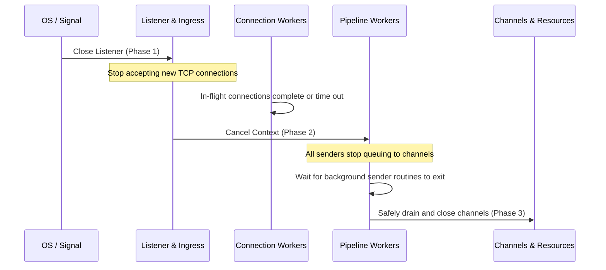

# Concurrency Architecture & Formal Invariants

## Abstract & Scope

This document specifies the formal concurrency model, synchronization invariants, lock hierarchies, and channel teardown protocols for `JA4proxy` (`cmd/ja4pd`, `internal/`).
As a high-throughput, low-latency TLS passthrough security proxy, `JA4proxy` processes tens of thousands of concurrent connections while concurrently ingesting dynamic threat feeds, handling configuration reloads (SIGHUP/PubSub), and streaming behavioral analytics.

Any concurrency defect—such as torn reads across hot reloads, channel closure races, buffer pool aliasing, or lock inversion deadlocks—results in severe operational failures: connection drops, decision poisoning, security bypasses, or daemon panics.

This document serves as the architectural contract enforced across all code and automated testing gates.

---

## 1. Formal Lock Hierarchy: Strict Partial Order

To prevent circular wait conditions (deadlocks), all mutexes across the codebase obey a strict partial order ($\prec$). A goroutine holding lock $L_A$ may acquire lock $L_B$ if and only if $L_A \prec L_B$. Nested acquisitions in the reverse direction ($L_B \prec L_A$) or horizontal recursive acquisitions are strictly forbidden.

$$L_{\text{Server}} \prec L_{\text{Pipeline}} \prec L_{\text{Tarpit}} \prec L_{\text{TrustedCIDRs}} \prec L_{\text{DecisionCache}}$$

### Detailed Mutex Definitions:

| Tier | Lock | Scope / Struct | Responsibility | May Acquire Downstream? |
| :--- | :--- | :--- | :--- | :--- |
| **1** | $L_{\text{Server}}$ | `internal/server/server.go: ProxyServer.mu` | Server listener lifecycle, active connection tracking, graceful drain. | Can acquire $L_{\text{Pipeline}}$, $L_{\text{Tarpit}}$, $L_{\text{DecisionCache}}$. |
| **2** | $L_{\text{Pipeline}}$ | `internal/security/pipeline.go: Pipeline.mu` | Synchronizes dynamic updates (`ReplaceConfig`, `UpdateSets`, `UpdateDynamicCIDRs`). | Can acquire $L_{\text{Tarpit}}$, $L_{\text{TrustedCIDRs}}$, $L_{\text{DecisionCache}}$. **Never** $L_{\text{Server}}$. |
| **3** | $L_{\text{Tarpit}}$ | `internal/server/tarpit.go: TarpitManager.mu` | Tarpit slot accounting, delay queues, client write pacing. | Can acquire $L_{\text{TrustedCIDRs}}$, $L_{\text{DecisionCache}}$. **Never** $L_{\text{Pipeline}}$ or $L_{\text{Server}}$. |
| **4** | $L_{\text{TrustedCIDRs}}$| `internal/server/proxy.go: TrustedCIDRs.mu` | In-memory CIDR trie for PROXY protocol upstream verification. | Can acquire $L_{\text{DecisionCache}}$. **Never** upstream locks. |
| **5** | $L_{\text{DecisionCache}}$ | `internal/security/cache.go: DecisionCache.mu` | Leaf-level LRU map & TTL cache for per-connection decisions. | **Leaf Lock:** Must NOT acquire ANY other lock while held. |

### Auxiliary / Leaf Locks:
- Module internal state locks (e.g., `FeedDownloader.mu`, `RateLimiter.mu`, `OffenseCounter.mu`, `BeaconingDetector.mu`) are strictly **Leaf Locks**. They must never nest any other mutex calls inside their critical sections.
- When dynamic lock checking is enabled via test tags (`deadlock`), `github.com/sasha-s/go-deadlock` detects and reports any out-of-order acquisitions or lock holds exceeding 2 seconds.

---

## 2. Lock-Free Connection Evaluation via Atomic Snapshotting

### The Problem: Torn Evaluations & Staggered RLock
Historically, evaluating a connection through `Pipeline` involved multiple staggered calls to `p.mu.RLock()`:
1. `Process()` acquired `p.mu.RLock()` to check blocklists.
2. `processInternal()` acquired `p.mu.RLock()` to copy 15+ module references into local variables.
3. `checkHardBlocks()` and `checkBypasses()` each acquired `p.mu.RLock()` to inspect blacklist and whitelist maps.

If a dynamic configuration reload (`ReplaceConfig`) or feed update occurred in between these staggered acquisitions, an in-flight connection could be evaluated using half-old and half-new policy rules (a torn configuration state), violating policy consistency.

### Architectural Invariant: Immutable `PipelineSnapshot`
The Pipeline uses True Copy-on-Write via `atomic.Pointer[PipelineSnapshot]`:

```go
type PipelineSnapshot struct {
    cfg            *PipelineConfig
    scorer         *RiskScorer
    decider        *ActionDecider
    tlsEnforcer    *TLSEnforcer
    sniAnalyzer    *SNIAnalyzer
    rateLimiter    *RateLimiter
    tcpAnalyzer    *TCPAnalyzer
    asnClassifier  *ASNClassifier
    dnsEnrichment  *DNSEnrichment
    blocklists     *BlocklistManager
    beaconing      *BeaconingDetector
    abuseipdb      *AbuseIPDB
    rdap           *RDAPEnricher
    tapConsumer    *TapConsumer
    ja4tConsumer   *JA4TConsumer
    offenseCounter *OffenseCounter

    // Dynamic Lists (read-only in snapshot)
    whitelist      map[string]bool
    blacklist      map[string]bool
    dynamicCIDR    cidranger.Ranger
    ja4xWhitelist  map[string]bool
    ja4xBlacklist  map[string]bool
}
```

### Invariant Rules:
1. **Zero Locks on Hot Path:** `Process()` and `processInternal()` load the snapshot exactly once via `snap := p.snapshot.Load()` at entry and evaluate all checks against `snap`. No read lock is acquired on the fast path.
2. **Immutable Snapshot Guarantee:** Once stored in `p.snapshot`, a `PipelineSnapshot` and its internal maps are immutable.
3. **Atomic Replacement:** Writers (`ReplaceConfig`, `UpdateSets`, `UpdateJA4XSets`, `UpdateDynamicCIDRs`) acquire `p.mu.Lock()`, construct or clone a new `PipelineSnapshot`, and store it atomically via `p.snapshot.Store(newSnap)`. In-flight connections complete against the snapshot they loaded without lock contention.

---

## 3. Two-Phase Channel Teardown Protocol

### The Panic Risk: Send on Closed Channel
In Go, sending on a closed channel immediately triggers an unrecoverable panic:
```text
panic: send on closed channel
```
Because connection ingress goroutines run concurrently with server shutdown signals, blindly closing work channels (`workChan`, `beaconingJobs`, `auditJobs`) while worker goroutines are attempting to send causes fatal crashes.

### The Protocol: Sender-Drains-Before-Close
Channels MUST only be closed after all potential senders have demonstrably exited. The shutdown sequence is strictly phased:



1. **Phase 1 (Stop Ingress):** Close the TCP listener (`listener.Close()`). No new connections are accepted.
2. **Phase 2 (Drain Senders):** Wait for active connection handlers (`sync.WaitGroup`) to terminate.
3. **Phase 3 (Cancel Context):** Cancel `ctx.Done()`, signaling internal background workers to exit.
4. **Phase 4 (Channel Closure):** Only when all senders have exited may worker channels be closed, or alternatively, let channels be garbage collected naturally without explicit closure if workers exit via `ctx.Done()`.

---

## 4. Background Enrichment Lifecycle & WaitGroup Handshakes

### The Problem: Competing Leaked Workers
Enrichment modules (`DNSEnrichment`, `RDAPEnricher`, `AbuseIPDB`, `FeedDownloader`) spawn background worker goroutines. In earlier revisions, `ReplaceConfig` cancelled their context but did not wait for the workers to terminate before spawning new workers. Under rapid SIGHUP loops, dozens of orphaned goroutines competed for CPU, memory, and Redis connections.

### Invariant Rules:
1. Every enrichment module that spawns background goroutines must track them using `sync.WaitGroup`.
2. Every enrichment module must expose a `Stop() / Wait()` method that cancels its context and blocks until `wg.Wait()` completes.
3. In `Pipeline.ReplaceConfig` and `Pipeline.Stop`, old workers MUST be waited on before new workers are initialized and spawned.

---

## 5. Buffer Pool Ownership & Zero Post-Return Aliasing

### The Problem: Byte Slice Reuse Corruption
`internal/server/forward.go` utilizes `sync.Pool` (`BufferPool`) to allocate 32 KiB I/O copy buffers.
If a buffer reference escapes its stack frame—such as being passed asynchronously to a logging hook, telemetry callback, or TAP sniffer—and is subsequently returned to the pool via `pool.Put(buf)`, another goroutine will acquire the buffer and overwrite its memory while the first goroutine is still reading it. This corrupts JA4 fingerprint calculation or TLS ClientHello parsing.

### Invariant Rules:
1. Buffers borrowed from `sync.Pool` are owned strictly by the acquiring goroutine.
2. A borrowed buffer MUST NOT be passed across goroutine boundaries.
3. Any data that must outlive the immediate read/write cycle or be passed to an asynchronous function MUST be defensively copied:
   ```go
   cleanCopy := make([]byte, n)
   copy(cleanCopy, poolBuf[:n])
   go asyncConsumer(cleanCopy)
   ```
4. `pool.Put(buf)` must be called strictly within a `defer` or cleanup block in the same function where the buffer was leased.

---

## 6. Static Analysis & Continuous Verification

The concurrency invariants defined here are enforced by multi-layered automated tooling in CI and local test gates:

1. **Static Linters (`.golangci.yaml`):**
   - `govet (copylocks)`: Prevents accidental mutex copying by value.
   - `gocritic`: Validates mutex hygiene (`badLock`, `badSyncOnceFunc`, `exposedSyncMutex`, `syncMapLoadAndDelete`).
   - `contextcheck`: Enforces context propagation across asynchronous boundaries.
2. **Goroutine Leak Sanitization (`uber-go/goleak`):**
   - Every package test must run `goleak.VerifyNone(t)` to assert zero lingering goroutines, timers, or tickers upon completion.
3. **Property-Based Linearizability (`pgregory.net/rapid`):**
   - 10,000+ randomized concurrent read/write/reload cycles verifying state consistency.
4. **Stress & Thread Preemption Harness (`make test-race-stress`):**
   - Continuous testing under `-race -count=50` varying `GOMAXPROCS=1,2,4,8,16,32`.
