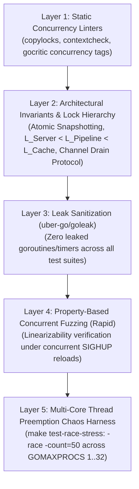

# Concurrency Assurance & Systematic Race Condition Elimination

## Goal

Design and execute a systematic, defence-in-depth engineering programme to proactively detect, eliminate, and permanently prevent race conditions, memory synchronization bugs, and deadlock risks across `JA4proxy`'s Go high-throughput proxy pipeline (`cmd/ja4pd`, `internal/`) and Python analytics/management workers. Shift race detection left into compile-time linters, property-based concurrent fuzzing, static lock-order auditing, leak sanitizers, and CI stress runners.

---

## The Threat: Why Concurrency Bugs Are Lethal in Network Proxies

In a TLS security proxy handling tens of thousands of concurrent connections:
1. **Decision Bleeding / Cross-Connection Leakage:** Unsynchronized data structures, torn read locks, or pooled buffer re-use leak one client's connection context (SNI, ALPN, IP, or JA4 fingerprint) into another client's decision evaluation, causing false blocks on legitimate users or security bypasses on malicious actors.
2. **Silent Fail-Closed Denial of Service:** Deadlocks or lock inversions during dynamic configuration reloads (SIGHUP) freeze connection worker pools, causing catastrophic dropped handshakes.
3. **State Corruption & Cache Poisoning:** Data races on shared counters, sorted sets (beaconing), or in-memory LRUs lead to inconsistent decision states that deviate silently from policy.
4. **Panic on Send to Closed Channel:** Uncoordinated shutdown or channel closing while ingress workers are sending crashes the entire proxy daemon.
5. **Non-Deterministic Heisenbugs:** Untracked races only surface under extreme production burst loads and escape standard unit testing unless systematically hunted under concurrency stress.

---

## Scope

### Included
1. **Lock Ordering & Concurrency Hierarchy ($L_{Server} \prec L_{Pipeline} \prec L_{Cache}$):**
   - Establish and document a strict partial lock hierarchy across all mutexes:
     $$L_{Server} \prec L_{Pipeline} \prec L_{Tarpit} \prec L_{TrustedCIDRs} \prec L_{DecisionCache}$$
   - Forbid nested lock acquisitions in reverse order.
   - Integrate `sasha-s/go-deadlock` under test build tags to dynamically verify lock hierarchy violations, lock hold timeouts, and potential AB-BA deadlocks at runtime.
2. **True Copy-on-Write (Atomic Snapshotting):**
   - Eliminate multiple staggered `p.mu.RLock()` calls across `Process()`, `checkHardBlocks()`, and `processInternal()`.
   - Introduce an atomic snapshot pointer (`atomic.Pointer[PipelineSnapshot]`). One connection evaluation must see one immutable snapshot for its entire lifecycle, guaranteeing zero torn configuration state during SIGHUP reloads.
3. **Two-Phase Channel Teardown Protocol:**
   - Eliminate panic-on-send-to-closed-channel bugs.
   - Enforce a strict two-phase drain protocol:
     1. Stop network ingress (`Listener.Close()`).
     2. Wait for in-flight connection handlers to complete.
     3. Signal worker cancellation via `context.Context`.
     4. Close worker channels (`workChan`, `beaconingJobs`, `auditJobs`) only after all sender goroutines have terminated.
4. **Goroutine Termination Handshake (`sync.WaitGroup`):**
   - Require `Pipeline.ReplaceConfig` and `Stop` to wait for previous background enrichment workers (DNS, RDAP, AbuseIPDB, feed downloader) to cleanly terminate via `sync.WaitGroup` before spawning new instances, eliminating competing background workers.
5. **Leak Prevention (`uber-go/goleak`):**
   - Enforce `goleak.VerifyNone(t)` in all test suites across `internal/security/`, `internal/server/`, and `cmd/ja4pd/` to permanently prevent goroutine, ticker, and timer leaks.
6. **Property-Based Concurrent State Machine Testing (`rapid`):**
   - Model the Pipeline, DecisionCache, and OffenseCounter as concurrent state machines.
   - Use `pgregory.net/rapid` to run 10,000+ randomized operations (`Process`, `ReplaceConfig`, `UpdateSets`, `Get`, `Set`) concurrently across 16 parallel goroutines to verify linearizability.
7. **Buffer Pool Ownership & Defensive Copying:**
   - Audit `sync.Pool` usage (`BufferPool` in `internal/server/proxy.go`). Enforce that any byte slices escaping to async workers or telemetry callbacks receive defensive copies before buffers are returned to the pool via `Put()`.
8. **Static Concurrency Linters in `.golangci.yml`:**
   - Enable `copylocks` (prevent copying mutexes by value).
   - Enable `contextcheck` (ensure context propagation).
   - Enable `gocritic` concurrency tags (`syncWait`, `rangeValCopy`, `badCond`).
   - Enable `rowserrcheck` and `fatcontext`.
9. **Multi-Core Thread Preemption Chaos Stress Harness:**
   - Author `scripts/run-concurrency-stress.sh` (`make test-race-stress`):
     - Run targeted high-contention test suites under `-race -count=50`.
     - Vary `GOMAXPROCS=1,2,4,8,16,32` with synthetic thread interleaving to expose micro-races.

### Out of Scope
- Rewriting the proxy architecture to single-threaded event-driven models (the multi-goroutine model is load-bearing for high-throughput TLS offload).

---

## Architectural Strategy: 5 Layers of Defense

---

## Implementation Plan

### Stage 1: Static Linters & Tooling Integration
- [ ] Update `.golangci.yml` with `copylocks`, `contextcheck`, and `gocritic` concurrency rules.
- [ ] Add `uber-go/goleak` and `sasha-s/go-deadlock` dependencies.
- [ ] Add `make lint-concurrency` and verify 0 violations.

### Stage 2: Lock Hierarchy & Atomic Snapshotting Refactor
- [ ] Formalize lock order in `docs/architecture/CONCURRENCY.md`.
- [ ] Refactor `Pipeline` to use `atomic.Pointer[PipelineSnapshot]` for zero-lock connection evaluation.
- [ ] Fix DecisionCache TOCTOU lock transition in `cache.go`.
- [ ] Add `sync.WaitGroup` termination handshakes in `Pipeline.ReplaceConfig` and enrichment modules.

### Stage 3: Two-Phase Channel Teardown Protocol
- [ ] Implement two-phase drain in `server.go` and `pipeline.go` preventing send-on-closed-channel panics.
- [ ] Audit buffer pool lifecycle in `proxy.go` to guarantee zero post-`Put()` pointer aliasing.

### Stage 4: Concurrent Fuzzing & Stress Test Suites
- [ ] Author `internal/security/concurrency_property_test.go` using `pgregory.net/rapid` (10,000 iterations).
- [ ] Author `internal/security/pipeline_concurrency_stress_test.go` executing 100 concurrent workers under continuous SIGHUP config reloads.
- [ ] Implement `scripts/run-concurrency-stress.sh` and `make test-race-stress`.

---

## Test Strategy & Validation Criteria

1. **Zero Data Races:**
   - `make test-race-stress` passes cleanly across all packages under `-race -count=50`.
2. **Zero Leaked Goroutines:**
   - Every Go test package passes `goleak.VerifyNone(t)`.
3. **Deadlock Freedom:**
   - Zero lock inversions detected by `go-deadlock` during concurrent reload benchmarks.
4. **Linearizability Proof:**
   - `rapid` property test completes 10,000 iterations of concurrent reads, writes, and reloads with 0 inconsistencies.

---

## Acceptance Criteria

- [ ] `PHASE_842.md` updated and approved by Concurrency Expert.
- [ ] Concurrency linters enabled in `.golangci.yml` and clean in `make lint`.
- [ ] `atomic.Pointer[PipelineSnapshot]` implemented in `internal/security/pipeline.go`.
- [ ] Zero goroutine leaks validated via `uber-go/goleak`.
- [ ] `make test-race-stress` added and 100% green.
- [ ] `make lint-phases` exits 0.
