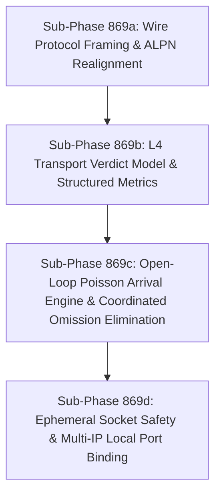

# Modernize Macro Load Generator (ja4bench v2)

## Goal
Modernize the JA4proxy macro benchmark load generator (`internal/test/bench/ja4bench.go`) from an uncalibrated, closed-loop synchronous generator suffering from Coordinated Omission, socket exhaustion, and protocol framing mismatches into an honest, open-loop arrival generator with explicit L4 decision telemetry verification, RFC-compliant ALPN handling, and local port ceiling scaling.

---

## Background & Architectural Audit Findings

As documented in `docs/reports/PERFORMANCE_HARNESS_REVIEW.md` and verified in `docs/reviews/phase_867_reaudit.md`:
1. **Queueing Saturation & Coordinated Omission (§3.1, §3.2)**: `ja4bench.go` executes single-request synchronous loops with single-buffered `time.Ticker`. Under Little's Law ($L = \lambda W$), when proxy latency spikes, ticks are dropped and the generator slows down. Consequently, p95 and p99 metrics mask queueing delays.
2. **ALPN / Protocol Framing Mismatch (§1.1, §3.4.1)**: `ja4bench.go:321` advertises `conf.NextProtos = []string{"h2", "http/1.1"}`. In a TLS-terminating or protocol-aware endpoint negotiating `h2`, sending raw ASCII `HTTP/1.1` violates RFC 7540 / RFC 9113 §3.5. Moreover, JA4proxy is a pure L4 stream forwarder without ALPN renegotiation; load generation must align with clean L4 stream tests.
3. **Verdict Model Realignment (§3.4.2, Re-Audit F-01)**: The proxy does not emit HTTP 403 or 429 origin responses. Enforcement on the TLS port (`internal/server/server.go:545-554`) executes an immediate TCP RST (`SetLinger(0)` + close) for `block`/`ban`, tarpitting for `tarpit`, or stream forwarding for `allow`/`flag`/`rate_limit`. The benchmark must record transport outcomes (clean close vs RST vs timeout) and verify against proxy decision metrics rather than checking for non-existent HTTP origin statuses.
4. **Local Ephemeral Port Ceiling (§3.3)**: Synthetic `Connection: close` loops consume ~28,232 ephemeral ports in <30s at 1,000 CPS ($T_{exhaust} = N_{ports}/\lambda$), generating `EADDRNOTAVAIL` socket errors. The generator must detect exhaustion, inspect host sysctls, and support multi-IP binding.

---

## Sub-Phase Decomposition Overview

All sub-phases are strictly sized as **SMALL** (<200 LOC per step, 1-2 files changed, autonomous unit/integration tests).

---

## Sub-Phase 869a: Wire Protocol Framing & ALPN Realignment (SMALL)

### 1. Name & Summary
**Phase 869a**: Wire Protocol Framing & ALPN Realignment.
Eliminate HTTP/2 ALPN wire mismatch by aligning client TLS negotiation with the L4 proxy forwarding model, preventing protocol framing corruption while preserving authentic TLS fingerprint generation.

### 2. Files to Create / Modify
- Modify: `internal/test/bench/ja4bench.go` (lines ~315-345)
- Modify: `internal/test/bench/ja4bench_test.go`

### 3. Implementation Specification
- In `internal/test/bench/ja4bench.go`:
  - Remove unconditional ALPN `[]string{"h2", "http/1.1"}` in `runProfile` when HTTP/1.1 payloads are sent.
  - Introduce configurable flag `-alpn` (default: `"http/1.1"`), with valid options `"http/1.1"`, `"h2"`, `"none"`.
  - When `-alpn http/1.1` or `"none"`, configure `conf.NextProtos` appropriately (omitted or `[]string{"http/1.1"}`).
  - When `-alpn h2`, send an RFC 7540 compliant client preface (`PRI * HTTP/2.0\r\n\r\nSM\r\n\r\n`) with an initial empty `SETTINGS` frame (or use standard `x/net/http2` transport) rather than raw ASCII HTTP/1.1.
- In `ja4bench_test.go`:
  - Add unit test verifying `conf.NextProtos` reflects the `-alpn` flag.
  - Test hermetic TLS server receiving expected connection preface.

### 4. Test Strategy
- Unit test: `GOROOT=/snap/go/current /snap/go/current/bin/go test -v ./internal/test/bench -run TestALPNFraming`
- Regression test: `GOROOT=/snap/go/current /snap/go/current/bin/go test -v ./internal/test/bench`

### 5. Acceptance Criteria
- No RFC 7540 connection preface errors occur during TLS handshakes.
- `internal/test/bench` tests pass with zero failures.
- Changed lines < 150 LOC.

---

## Sub-Phase 869b: L4 Transport Verdict Model & Structured Metrics (SMALL)

### 1. Name & Summary
**Phase 869b**: L4 Transport Verdict Model & Structured Metrics.
Replace flawed HTTP-centric assumptions with an honest L4 verdict classification (forwarded/completed, abrupt TCP RST, tarpit/timeout) and cross-reference against proxy decision counters.

### 2. Files to Create / Modify
- Modify: `internal/test/bench/ja4bench.go`
- Modify: `internal/test/bench/ja4bench_test.go`

### 3. Implementation Specification
- In `internal/test/bench/ja4bench.go`:
  - Extend `BenchResult` with distinct transport outcome counters:
    - `ConnsForwarded`: successful TLS handshake + backend payload exchange.
    - `ConnsReset`: connection reset (`ECONNRESET` / TCP RST from `SetLinger(0)` enforcement).
    - `ConnsTimeout`: connection timeout (e.g. tarpit enforcement exceeding client timeout).
    - `TransportErrors`: socket allocation or handshake failures (`EADDRNOTAVAIL`, etc.).
  - Update `Record()` method to classify errors accurately based on `errors.Is(err, syscall.ECONNRESET)` or timeout inspection.
  - In `Status()`:
    - For bad traffic profiles: verify that blocked connections map to `ConnsReset` or `ConnsTimeout` (true positives), rather than incrementing `GoodBlocked`.
    - For good traffic profiles: verify that expected traffic maps to `ConnsForwarded`.
  - Add JSON serialization fields for new counters.

### 4. Test Strategy
- Unit test: Create hermetic tests in `ja4bench_test.go` with mock listeners:
  - Standard echo listener -> increments `ConnsForwarded`.
  - RST listener (`SetLinger(0)`) -> increments `ConnsReset`.
  - Blackhole listener with client timeout -> increments `ConnsTimeout`.
- Run: `GOROOT=/snap/go/current /snap/go/current/bin/go test -v ./internal/test/bench -run TestVerdictClassification`

### 5. Acceptance Criteria
- `ja4bench` cleanly separates network anomalies from deliberate proxy security enforcement.
- Unit tests verify all three L4 transport verdicts.
- Code changes < 180 LOC.

---

## Sub-Phase 869c: Open-Loop Poisson Arrival Engine & Coordinated Omission Elimination (SMALL)

### 1. Name & Summary
**Phase 869c**: Open-Loop Poisson Arrival Engine & Coordinated Omission Elimination.
Decouple request generation timing from connection completion latency using scheduled arrival offsets, tracking wait latency and service latency independently to eliminate Coordinated Omission.

### 2. Files to Create / Modify
- Modify: `internal/test/bench/ja4bench.go`
- Modify: `internal/test/bench/ja4bench_test.go`

### 3. Implementation Specification
- In `internal/test/bench/ja4bench.go`:
  - Implement an open-loop arrival schedule generator:
    - Generate scheduled arrival times $T_{sched} = T_0 + i \cdot \Delta t$ (or Poisson exponential intervals $- \ln(U)/\lambda$).
    - Worker pool or goroutine dispatcher dispatches requests at $T_{sched}$ independently of whether prior requests have completed.
    - If a worker pool is busy, record `WaitTime = T_{actual\_start} - T_{sched}`.
  - Latency tracking:
    - Record `ServiceTime = T_{resp} - T_{actual\_start}`.
    - Record `TotalLatency = T_{resp} - T_{sched}` ($= \text{WaitTime} + \text{ServiceTime}$).
    - Add `P95WaitMS`, `P99WaitMS`, `P95TotalMS`, `P99TotalMS` to `BenchResult`.
  - Cap maximum in-flight connections (safety valve `-max-inflight`, default 5000) to prevent unbounded memory growth if target stops responding.

### 4. Test Strategy
- Unit test: Simulate a 100ms artificial pause in a test server; assert that open-loop arrival accounts for accumulated queueing wait time in `TotalLatency`, proving Coordinated Omission is eliminated.
- Run: `GOROOT=/snap/go/current /snap/go/current/bin/go test -v ./internal/test/bench -run TestOpenLoopCoordinatedOmission`

### 5. Acceptance Criteria
- Artificial proxy stall causes tail latency (p95/p99) to surge proportionally rather than dropping samples.
- Throughput remains faithful to offered rate up to `-max-inflight` bound.
- Code changes < 200 LOC.

---

## Sub-Phase 869d: Ephemeral Socket Safety & Multi-IP Local Port Binding (SMALL)

### 1. Name & Summary
**Phase 869d**: Ephemeral Socket Safety & Multi-IP Local Port Binding.
Prevent client-side TCP `TIME_WAIT` port exhaustion by inspecting kernel parameters, exposing rotating local IP bindings, and detecting `EADDRNOTAVAIL` socket errors.

### 2. Files to Create / Modify
- Modify: `internal/test/bench/ja4bench.go`
- Create: `internal/test/bench/sysctl_linux.go`
- Create: `internal/test/bench/sysctl_other.go`
- Modify: `internal/test/bench/ja4bench_test.go`

### 3. Implementation Specification
- In `internal/test/bench/sysctl_linux.go`:
  - Read `/proc/sys/net/ipv4/ip_local_port_range` and `/proc/sys/net/ipv4/tcp_tw_reuse`.
  - Provide helper `CheckPortRange() (min, max int, twReuse bool, err error)`.
- In `internal/test/bench/sysctl_other.go` (for non-linux systems):
  - Return sensible defaults (min: 32768, max: 60999, twReuse: false, err: nil).
- In `internal/test/bench/ja4bench.go`:
  - Add flag `-bind-ips` (comma-separated list of local source IPs, e.g. `127.0.0.1,127.0.0.2,127.0.0.3`).
  - In `net.Dialer`, round-robin the `LocalAddr` across provided `-bind-ips` to multiply available ephemeral ports ($N_{ports} \times N_{ips}$).
  - Detect `EADDRNOTAVAIL` specifically and print operator guidance (`"Warning: local ephemeral port exhaustion detected; enable net.ipv4.tcp_tw_reuse=1 or specify multiple --bind-ips"`).
  - Include port exhaustion warning in JSON output (`"port_exhaustion_detected": true`).

### 4. Test Strategy
- Unit test: Test `CheckPortRange` parsing against simulated `/proc` strings.
- Unit test: Verify `net.Dialer.LocalAddr` cycles across specified `-bind-ips`.
- Run: `GOROOT=/snap/go/current /snap/go/current/bin/go test -v ./internal/test/bench -run TestBindIPs`

### 5. Acceptance Criteria
- Multi-IP binding multiplies connection capacity across loopback.
- Port exhaustion is explicitly diagnosed and does not count as a proxy failure.
- Code changes < 190 LOC.
