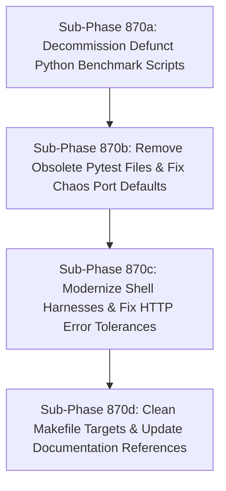

# Deprecate Zombie Benchmarks & Repository Hygiene

## Goal
Safely remove obsolete, non-functional Python performance benchmark runners referencing deleted Python proxy components, eliminate broken shell scripts, update Makefile targets, and resolve configuration drift across active performance scripts.

---

## Background & Architectural Audit Findings

As documented in `docs/reports/PERFORMANCE_HARNESS_REVIEW.md`:
1. **Dead Code Referencing Deleted Proxy (`proxy.py`)**: `scripts/benchmark_comparison.py` (2,032 LOC) and `tests/performance/benchmark_phase26.py` / `benchmark_parallel_signals.py` attempt to import `from src.security.pipeline import ConnectionContext, Pipeline`. They fail immediately if run.
2. **Defunct Python Tap Benchmark**: `scripts/tap_benchmark.py` imports deleted `src.tap.capture` instead of Go `cmd/ja4-tap`.
3. **Flawed Mutex Sleep**: `scripts/benchmark.py` contains a token-bucket mutex deadlock (`with self.lock: time.sleep(...)`) that caps generation $<200$ CPS.
4. **Shell Script Inadequacies**: `scripts/basic_perf_test.sh` accepts HTTP `502` and `503` as successful responses (`grep -q "200\|502\|503"`).
5. **Configuration Drift**: `scripts/bench-hostnative.sh` points to default port `18080` instead of canonical `HOST_PORT_DIRECT` (`8080`), and references in chaos tests (`test_go_proxy_chaos.py`) point to legacy port `18082`.

---

## Sub-Phase Decomposition Overview

All sub-phases are strictly sized as **SMALL** (<200 LOC per step, 1-2 files changed, autonomous unit/integration tests).

---

## Sub-Phase 870a: Decommission Defunct Python Benchmark Scripts (SMALL)

### 1. Name & Summary
**Phase 870a**: Decommission Defunct Python Benchmark Scripts.
Safely remove the zombie Python benchmark runners (`scripts/benchmark_comparison.py`, `scripts/benchmark.py`, `scripts/tap_benchmark.py`) that target the long-deleted Python proxy and contain concurrency deadlocks.

### 2. Files to Create / Modify
- Delete: `scripts/benchmark_comparison.py`
- Delete: `scripts/benchmark.py`
- Delete: `scripts/tap_benchmark.py`
- Modify: `docs/reference/SCRIPTS.md` (remove deleted script entries)

### 3. Implementation Specification
- Remove `scripts/benchmark_comparison.py` (2,032 lines).
- Remove `scripts/benchmark.py` (230 lines).
- Remove `scripts/tap_benchmark.py` (260 lines).
- Update `docs/reference/SCRIPTS.md` to remove inventory references and document their retirement in favor of `cmd/ja4pd` and `internal/test/bench/ja4bench.go`.

### 4. Test Strategy
- Verify tree builds and linters pass: `make lint`
- Verify documentation references pass lychee check: `make test-unit`

### 5. Acceptance Criteria
- Over 2,500 lines of dead, misleading benchmark code deleted.
- No dangling references in `docs/reference/SCRIPTS.md`.
- `make lint` passes.

---

## Sub-Phase 870b: Remove Obsolete Pytest Files & Fix Chaos Port Defaults (SMALL)

### 1. Name & Summary
**Phase 870b**: Remove Obsolete Pytest Files & Fix Chaos Port Defaults.
Remove broken performance tests under `tests/performance/` and rectify legacy port mismatches (`18082` -> `8080`) in chaos and performance pytest suites.

### 2. Files to Create / Modify
- Delete: `tests/performance/benchmark_phase26.py`
- Delete: `tests/performance/benchmark_parallel_signals.py`
- Modify: `tests/chaos/test_go_proxy_chaos.py` (update port defaults)
- Modify: `tests/performance/test_bench_go_proxy.py`

### 3. Implementation Specification
- Delete `tests/performance/benchmark_phase26.py` and `tests/performance/benchmark_parallel_signals.py` which import non-existent `src.security.pipeline`.
- In `tests/chaos/test_go_proxy_chaos.py` (line ~27): replace legacy fallback port `18082` with the canonical test port (`8080` / `18080`).
- Ensure `tests/performance/test_bench_go_proxy.py` cleanly runs under `$(TOOLS_RUN)` pointing to `ja4bench.go` / Go proxy ports.

### 4. Test Strategy
- Run pytest in container: `docker run --rm -v "$PWD":/src -w /src ja4proxy-tools pytest tests/performance/ tests/chaos/ -k "not integration"`
- Verify test discovery: `make test-unit`

### 5. Acceptance Criteria
- Pytest test collection discovers 0 broken imports.
- Chaos test port defaults match current docker/host port configurations.
- All unit tests pass cleanly inside container.

---

## Sub-Phase 870c: Modernize Shell Harnesses & Fix HTTP Error Tolerances (SMALL)

### 1. Name & Summary
**Phase 870c**: Modernize Shell Harnesses & Fix HTTP Error Tolerances.
Fix `scripts/basic_perf_test.sh` so it rejects 502/503 errors as failures, and synchronize `scripts/bench-hostnative.sh` default ports and metrics endpoints.

### 2. Files to Create / Modify
- Modify: `scripts/basic_perf_test.sh`
- Modify: `scripts/bench-hostnative.sh`

### 3. Implementation Specification
- In `scripts/basic_perf_test.sh`:
  - Replace `grep -q "200\|502\|503"` with strict `grep -q "200 OK"`.
  - Treat HTTP 502 Bad Gateway and 503 Service Unavailable as critical benchmark errors and increment error counter.
  - Fail execution if error rate > 0%.
- In `scripts/bench-hostnative.sh`:
  - Align `PROXY_PORT="${PROXY_PORT:-8080}"` (or explicitly document why `18080` is chosen to avoid Docker bridge collisions).
  - Clarify `METRICS_PORT` configuration (`29090` vs `9090`).
  - Add pre-flight check asserting that `ja4pd` binary is compiled and responsive.

### 4. Test Strategy
- Shell script syntax verification: `shellcheck scripts/basic_perf_test.sh scripts/bench-hostnative.sh`
- Local mock run: test `basic_perf_test.sh` against an intentional 502 responder to confirm non-zero exit code.

### 5. Acceptance Criteria
- `basic_perf_test.sh` fails on HTTP 502/503 responses.
- `bench-hostnative.sh` runs with zero ambiguous port bindings.
- Scripts pass shellcheck.

---

## Sub-Phase 870d: Clean Makefile Targets & Update Documentation References (SMALL)

### 1. Name & Summary
**Phase 870d**: Clean Makefile Targets & Update Documentation References.
Deprecate the obsolete `perf-test` Makefile target, ensure `bench-macro` and `test-go-perf` invoke the honest Go harness, and refresh developer documentation.

### 2. Files to Create / Modify
- Modify: `Makefile`
- Modify: `docs/reports/PERFORMANCE_HARNESS_REVIEW.md` (or relevant developer guide)

### 3. Implementation Specification
- In `Makefile`:
  - Deprecate or remove `perf-test` (which previously invoked `scripts/benchmark.py` / `load_test.py`).
  - Point `bench-macro` and `bench-all` exclusively to `internal/test/bench` (`ja4p test benchmark` or direct `go test ./internal/test/bench`).
  - Ensure Go benchmark targets use `GOROOT=$(GOROOT)` and native execution.
- Update developer docs to reflect that all performance benchmarks run through Go harnesses.

### 4. Test Strategy
- Test make target execution: `make -n bench-macro`
- Verify lint and phase validation: `make lint-phases`

### 5. Acceptance Criteria
- No Makefile target attempts to run deleted Python benchmark scripts.
- `make bench-macro` launches `ja4bench`.
- `make lint-phases` passes with exit code 0.
