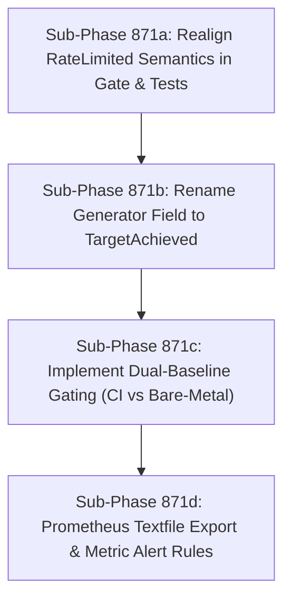

# Nightly Benchmark & CI Telemetry Gate Realignment

## Goal
Fix the inverted `RateLimited` logic in the nightly CI regression gate, decouple GitHub Actions ephemeral runner performance baselines from bare-metal host baselines (dual-baseline model), and export trend metrics to Prometheus textfile format with automated regression alert thresholds.

---

## Background & Architectural Audit Findings

As documented in `docs/reports/PERFORMANCE_HARNESS_REVIEW.md` and verified in `docs/reviews/phase_867_reaudit.md`:
1. **The Inverted `RateLimited` Gate Paradox (§3.5)**:
   - In `ja4bench.go:101-103`: `RateLimited = ThroughputCPS >= 0.9 * OfferedRateCPS`. (Indicates the generator achieved $\ge 90\%$ of the target rate).
   - In `scripts/nightly_benchmark_gate.py:82-86`: `if result.get("rate_limited", False): failures.append(...)`.
   - Result: If the proxy achieves full throughput (e.g. 950/1000 CPS), CI **fails**. If proxy performance collapses to 200 CPS, CI **passes**.
   - Note: Two existing unit tests currently lock this inverted logic in place (`internal/test/bench/ja4bench_test.go:191-216` & `tests/unit/test_nightly_benchmark_gate.py:106-115`), which must be updated deliberately together.
2. **CI Virtualized Runner vs Bare-Metal Discrepancy (§3.6)**:
   - GitHub Actions `ubuntu-latest` 2-core VMs share CPU cycles and virtualized bridge interfaces, capping out around ~600-750 CPS.
   - Host-native bare-metal proxies achieve >3,200 CPS. Comparing CI runs against bare-metal thresholds causes perpetual spurious CI failures or disables regression gating completely.
3. **Prometheus Textfile Collector Integration**:
   - As established in Phase 805, CI cannot directly push metrics to the self-hosted Prometheus.
   - Nightly benchmark telemetry must format into node-exporter textfile format (`.prom`) with alert metric thresholds (`ja4proxy_bench_throughput_cps`, `ja4proxy_bench_p95_latency_ms`).

---

## Sub-Phase Decomposition Overview

All sub-phases are strictly sized as **SMALL** (<200 LOC per step, 1-2 files changed, autonomous unit/integration tests).

---

## Sub-Phase 871a: Realign RateLimited Semantics in Gate & Tests (SMALL)

### 1. Name & Summary
**Phase 871a**: Realign RateLimited Semantics in Gate & Tests.
Fix `scripts/nightly_benchmark_gate.py` and its corresponding unit tests so that reaching the offered rate target is treated as a benchmark success rather than a regression failure.

### 2. Files to Create / Modify
- Modify: `scripts/nightly_benchmark_gate.py` (lines 80-87)
- Modify: `tests/unit/test_nightly_benchmark_gate.py` (lines 100-120)

### 3. Implementation Specification
- In `scripts/nightly_benchmark_gate.py`:
  - Change evaluation of `result.get("rate_limited")`:
    - If `target_rate_achieved` (or legacy `rate_limited`) is `False` when throughput is expected to saturate the target, log an advisory notice or regression warning if throughput is below the minimum floor.
    - Remove the check adding a failure when `rate_limited == True`. Reaching $\ge 90\%$ of offered rate is normal, healthy operation.
- In `tests/unit/test_nightly_benchmark_gate.py`:
  - Update `test_rate_limited_triggers_failure`: invert test expectation so that `rate_limited == True` does NOT produce a failure in `evaluate_results`.
  - Add test asserting that failing to achieve target rate logs an appropriate failure or warning if below throughput threshold.

### 4. Test Strategy
- Run unit tests in container:
  `docker run --rm -v "$PWD":/src -w /src ja4proxy-tools pytest tests/unit/test_nightly_benchmark_gate.py`

### 5. Acceptance Criteria
- `nightly_benchmark_gate.py` passes when throughput is within 90-100% of offered rate.
- Containerized pytest passes with 100% green tests.
- Code changes < 80 LOC.

---

## Sub-Phase 871b: Rename Generator Field to TargetAchieved (SMALL)

### 1. Name & Summary
**Phase 871b**: Rename Generator Field to TargetAchieved.
Clarify the ambiguous boolean in `ja4bench.go` from `RateLimited` to `TargetAchieved` (with JSON backwards-compatibility alias) and update Go unit tests.

### 2. Files to Create / Modify
- Modify: `internal/test/bench/ja4bench.go`
- Modify: `internal/test/bench/ja4bench_test.go`

### 3. Implementation Specification
- In `internal/test/bench/ja4bench.go`:
  - Add field `TargetAchieved bool `json:"target_achieved"`` to `BenchResult`.
  - Retain `RateLimited bool `json:"rate_limited,omitempty"`` populated identically for backwards compatibility with legacy JSON consumers.
  - Set `TargetAchieved = r.ThroughputCPS >= 0.9 * float64(r.OfferedRateCPS)`.
  - Add godoc comment clearly explaining that `TargetAchieved` means the load generator was able to deliver $\ge 90\%$ of the configured rate without client-side bottlenecking.
- In `internal/test/bench/ja4bench_test.go`:
  - Update assertions on `RateLimited` / `TargetAchieved` in `TestRunProfileHermetic_F2` and throughput calculation tests.

### 4. Test Strategy
- Run Go unit tests:
  `GOROOT=/snap/go/current /snap/go/current/bin/go test -v ./internal/test/bench`

### 5. Acceptance Criteria
- Go bench tests pass.
- JSON output produces both `target_achieved` and `rate_limited`.
- Code changes < 100 LOC.

---

## Sub-Phase 871c: Implement Dual-Baseline Gating (CI vs Bare-Metal) (SMALL)

### 1. Name & Summary
**Phase 871c**: Implement Dual-Baseline Gating (CI vs Bare-Metal).
Separate GitHub Actions ephemeral runner performance baselines from bare-metal host baselines, allowing realistic regression gating without false alarms.

### 2. Files to Create / Modify
- Modify: `scripts/nightly_benchmark_gate.py`
- Create/Modify: `scripts/nightly_benchmark_baseline_ci.json`
- Create/Modify: `scripts/nightly_benchmark_baseline_host.json`

### 3. Implementation Specification
- Split baseline JSON into two configuration profiles:
  - `nightly_benchmark_baseline_ci.json`: calibrated for standard 2-core GitHub Actions runners (e.g. ~600 CPS target, p95 ceiling 15ms).
  - `nightly_benchmark_baseline_host.json`: calibrated for host-native bare metal (e.g. ~3,000 CPS target, p95 ceiling 2.5ms).
- In `scripts/nightly_benchmark_gate.py`:
  - Add CLI argument `--profile {ci,host}` (or auto-detect via environment variable `CI=true`).
  - Load the appropriate baseline profile accordingly.
  - Fail with clear diagnostics if a run regresses against its specific environment baseline.

### 4. Test Strategy
- Unit test in container: verify both CI and Host baseline profiles parse and gate accurately.
  `docker run --rm -v "$PWD":/src -w /src ja4proxy-tools pytest tests/unit/test_nightly_benchmark_gate.py`

### 5. Acceptance Criteria
- CI runs evaluate against CI baseline; host runs evaluate against host baseline.
- No false regression failures on shared CI runners.
- Code changes < 150 LOC.

---

## Sub-Phase 871d: Prometheus Textfile Export & Metric Alert Rules (SMALL)

### 1. Name & Summary
**Phase 871d**: Prometheus Textfile Export & Metric Alert Rules.
Extend `scripts/export_ci_benchmark_textfile.sh` to export new L4 verdict metrics and latency distributions into node-exporter format and document Prometheus alerting rules.

### 2. Files to Create / Modify
- Modify: `scripts/export_ci_benchmark_textfile.sh`
- Create/Modify: `deploy/monitoring/rules/benchmark_alerts.yml`

### 3. Implementation Specification
- In `scripts/export_ci_benchmark_textfile.sh`:
  - Parse new fields from `result.json`:
    - `ja4proxy_benchmark_conns_forwarded_total`
    - `ja4proxy_benchmark_conns_reset_total`
    - `ja4proxy_benchmark_conns_timeout_total`
    - `ja4proxy_benchmark_wait_latency_p95_ms`
    - `ja4proxy_benchmark_total_latency_p95_ms`
  - Emit valid Prometheus textfile format with `# HELP` and `# TYPE` headers.
- In `deploy/monitoring/rules/benchmark_alerts.yml`:
  - Define Alertmanager rules alerting on:
    - Throughput regression > 25% over 7 days.
    - Tail latency (p95 total) > 2x baseline.

### 4. Test Strategy
- Run shell script against sample `result.json`:
  `bash scripts/export_ci_benchmark_textfile.sh /tmp/sample_result.json /tmp/benchmark.prom`
- Validate output syntax using `promtool check rules deploy/monitoring/rules/benchmark_alerts.yml` (or lint check).

### 5. Acceptance Criteria
- Exported `.prom` file parses cleanly without syntax errors.
- Alerting rules are syntactically valid Prometheus alert groups.
- Code changes < 160 LOC.
