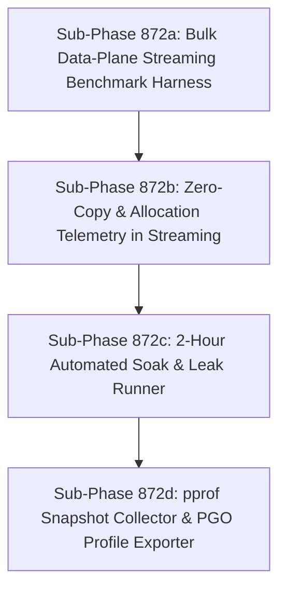

# High-Concurrency Data-Plane & Long-Duration Soak Suite

## Goal
Establish a high-concurrency persistent data-plane benchmark measuring bulk payload streaming throughput (Gbps) and GC allocation pressure under proxying, alongside an automated 2-hour soak test harness to detect memory leaks, file descriptor leaks, and goroutine accumulation under sustained load.

---

## Background & Architectural Audit Findings

As documented in `docs/reports/PERFORMANCE_HARNESS_REVIEW.md`:
1. **Zero Data-Plane Throughput Measurement (§6 row 3)**:
   - Existing benchmarks only execute short TLS handshakes with a 40-byte `GET /health` payload and terminate.
   - There is zero visibility into proxy memory buffer allocation (`sync.Pool` buffer churn, `io.Copy` GC overhead, TCP window scaling) when streaming multi-megabyte payloads at line rate (Gbps).
2. **Lack of Sustained Concurrency & Leak Testing (§6 row 6)**:
   - Current soak tests in `cmd/ja4pd/soak_leak_test.go` only run for 1,000 requests.
   - There is no long-duration soak test harness (1–2+ hours) exercising file descriptor exhaustion, slow goroutine leaks, or RSS memory drift under continuous 1,000–2,000 CPS load.
3. **Profile-Guided Optimization (PGO)**:
   - Go supports Profile-Guided Optimization (`default.pgo`). An authentic high-load benchmark profile is required to train the compiler for optimized hot paths.

---

## Sub-Phase Decomposition Overview

All sub-phases are strictly sized as **SMALL** (<200 LOC per step, 1-2 files changed, autonomous unit/integration tests).

---

## Sub-Phase 872a: Bulk Data-Plane Streaming Benchmark Harness (SMALL)

### 1. Name & Summary
**Phase 872a**: Bulk Data-Plane Streaming Benchmark Harness.
Implement a dedicated data-plane throughput benchmark (`cmd/ja4-stream-bench` or sub-command in `ja4bench`) that measures multi-gigabit bulk transfer rates over persistent TLS proxy connections.

### 2. Files to Create / Modify
- Create: `internal/test/bench/stream_bench.go`
- Create: `internal/test/bench/stream_bench_test.go`

### 3. Implementation Specification
- In `internal/test/bench/stream_bench.go`:
  - Implement streaming load generator function `RunStreamBenchmark(ctx context.Context, cfg StreamConfig) (*StreamResult, error)`.
  - Maintain $N$ concurrent persistent TLS connections (default 10-50).
  - Stream continuous payload data (e.g. 1MB - 10MB blocks) using `io.CopyN` or chunked writes through the proxy to an echo/discard backend.
  - Compute aggregate throughput:
    - `TotalBytesTransferred` (int64)
    - `ThroughputGbps` ($= \frac{\text{TotalBytes} \times 8}{\text{Duration} \times 10^9}$)
    - `TransferLatencyMS` per block
- In `stream_bench_test.go`:
  - Spin up in-process TLS listener and proxy mock to stream 10MB; verify `ThroughputGbps > 0` and error count is 0.

### 4. Test Strategy
- Unit test: `GOROOT=/snap/go/current /snap/go/current/bin/go test -v ./internal/test/bench -run TestStreamBenchmarkHermetic`

### 5. Acceptance Criteria
- Streams persistent payload chunks and reports Gbps line rate cleanly.
- Hermetic test completes within 5 seconds.
- Code changes < 190 LOC.

---

## Sub-Phase 872b: Zero-Copy & Allocation Telemetry in Streaming (SMALL)

### 1. Name & Summary
**Phase 872b**: Zero-Copy & Allocation Telemetry in Streaming.
Instrument buffer allocations, bytes per operation, and GC pause metrics during bulk data transfers to measure proxy memory pressure.

### 2. Files to Create / Modify
- Modify: `internal/test/bench/stream_bench.go`
- Modify: `cmd/ja4pd/bench_test.go` (or `internal/server/stream_bench_test.go`)

### 3. Implementation Specification
- In `internal/test/bench/stream_bench.go`:
  - Sample `runtime.ReadMemStats` before and after stream runs.
  - Track:
    - `AllocBytesPerMB`: memory allocated by the benchmark client per MB transferred.
    - `NumGC`: GC cycles triggered.
    - `PauseTotalNs`: total GC pause duration.
  - Query proxy `/debug/vars` or Prometheus `/metrics` for proxy-side heap allocation metrics if available.
- In `stream_bench_test.go`:
  - Assert allocation metrics are collected and formatted in the benchmark JSON output.

### 4. Test Strategy
- Run benchmark test with memory assertions:
  `GOROOT=/snap/go/current /snap/go/current/bin/go test -v ./internal/test/bench -run TestStreamAllocations`

### 5. Acceptance Criteria
- Streaming results include memory allocation and GC metrics.
- Code changes < 150 LOC.

---

## Sub-Phase 872c: 2-Hour Automated Soak & Leak Runner (SMALL)

### 1. Name & Summary
**Phase 872c**: 2-Hour Automated Soak & Leak Runner.
Implement a configurable soak testing script (`scripts/run_soak_test.sh` / `scripts/soak_runner.py`) that executes long-duration load and monitors file descriptors, goroutines, and memory RSS drift.

### 2. Files to Create / Modify
- Create: `scripts/run_soak_test.py`
- Create: `tests/unit/test_soak_runner.py`

### 3. Implementation Specification
- In `scripts/run_soak_test.py`:
  - CLI arguments: `--duration` (default: 7200s / 2 hours; supports short smoke `60s`), `--rate` (default: 1000 CPS), `--target` (default: `127.0.0.1:8080`).
  - Periodically (every 30s) poll:
    - Proxy process RSS memory (`/proc/<pid>/statm` or `ps`).
    - Open file descriptors count (`/proc/<pid>/fd` or `lsof`).
    - Goroutine count via `/debug/pprof/goroutine?debug=1`.
  - Regression detection:
    - Assert RSS does not increase linearly over time (leak slope check $< 5\%$ drift after warmup).
    - Assert FD count returns to baseline after bursts.
    - Assert goroutine count does not continually climb.
  - Exit code: 0 on stable run, 1 if memory/FD/goroutine leak detected.
- In `tests/unit/test_soak_runner.py`:
  - Unit test slope calculation and leak detection logic with mocked sample series.

### 4. Test Strategy
- Unit test in container:
  `docker run --rm -v "$PWD":/src -w /src ja4proxy-tools pytest tests/unit/test_soak_runner.py`
- Short smoke run:
  `python3 scripts/run_soak_test.py --duration 10s --mock` (or container equivalent)

### 5. Acceptance Criteria
- Soak runner accurately detects synthetic memory leaks and FD leaks.
- Unit tests pass inside containerized pytest.
- Code changes < 180 LOC.

---

## Sub-Phase 872d: pprof Snapshot Collector & PGO Profile Exporter (SMALL)

### 1. Name & Summary
**Phase 872d**: pprof Snapshot Collector & PGO Profile Exporter.
Add automated heap/goroutine pprof snapshot diffing to the soak harness and produce a production-representative `default.pgo` CPU profile.

### 2. Files to Create / Modify
- Modify: `scripts/run_soak_test.py`
- Create: `scripts/export_pgo_profile.sh`

### 3. Implementation Specification
- In `scripts/run_soak_test.py`:
  - On test start and test completion, download `/debug/pprof/heap` and `/debug/pprof/goroutine`.
  - Save to `reports/soak/heap_start.pprof` and `reports/soak/heap_end.pprof`.
  - Generate textual diff report via `go tool pprof -top -diff_base=...` if Go is available.
- In `scripts/export_pgo_profile.sh`:
  - Collect 60-second CPU profile during peak soak run (`curl -s -o cpu.pprof http://localhost:6060/debug/pprof/profile?seconds=60`).
  - Format and validate profile for compiler consumption as `cmd/ja4pd/default.pgo`.

### 4. Test Strategy
- Shell syntax test: `shellcheck scripts/export_pgo_profile.sh`
- Mock pprof collection verification in container.

### 5. Acceptance Criteria
- Soak test archives heap diffs upon completion.
- PGO exporter script reliably fetches valid pprof profile.
- Code changes < 150 LOC.
