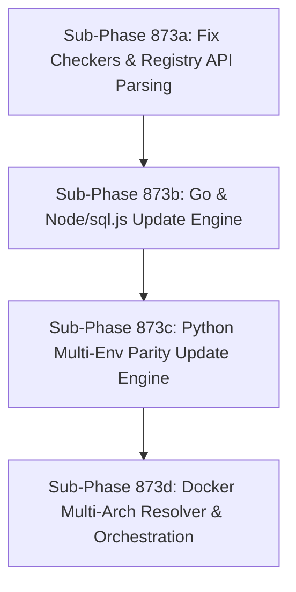

# Unified Dependency Update Engine (Docker, Go, Python, Node) & Daily Cron Orchestration

## Goal
Implement a single-command dependency update pipeline (`make update-all`) that checks and updates all external dependencies across Docker digests, Go modules, Python multi-environment requirement files, and Node/sql.js vendor libraries, backed by container-strict validation and a self-contained daily cron maintenance script.

---

## Architecture & Sub-Phase Decomposition

All sub-phases are sized as **SMALL** and sequentially decoupled to allow autonomous execution by junior developers.

---

## Sub-Phase 873a: Fix Update-Checker Container & Registry API Parsing (SMALL)

### 1. Goal & Scope
Fix registry API queries and non-root container permissions in `scripts/check_updates.py` and `deploy/docker/update-checker/Dockerfile` so that `make check-updates-container` and `scripts/check_updates.py` execute with 0 errors.

### 2. Implementation Steps
1. In `scripts/check_updates.py`:
   - Strip `@sha256:...` digest strings from image references before querying the Docker Hub and GCR tag APIs (resolves HTTP 400 Bad Request).
   - Add missing first-party internal images (`ja4proxy-tap`, `ja4proxy-logtide`, `ja4proxy-attacker`, `ja4proxy-proxy`) to `FIRST_PARTY_IMAGES` so they are excluded from upstream registry lookups (resolves HTTP 404 Not Found).
2. In `deploy/docker/update-checker/Dockerfile`:
   - Set environment variables `ENV GOCACHE=/tmp/gocache GOPATH=/tmp/gopath PIP_CACHE_DIR=/tmp/pip-cache`.
   - Ensure `/tmp/gocache`, `/tmp/gopath`, and `/tmp/pip-cache` are created with permissions `1777` prior to switching to `USER checker`.
3. Unit test coverage:
   - Create `tests/unit/test_check_updates.py` mocking registry responses, asserting that digests are stripped, first-party images are filtered out, and non-root cache paths are honored.

### 3. Acceptance Criteria
- `scripts/check_updates.py --format json` runs with zero registry errors (no 400 Bad Request, no 404 Not Found).
- `make check-updates-container` builds cleanly and runs Go, Python, Node, and Docker checks without cache permission failures.
- Unit tests pass inside containerized pytest: `make test-unit`.

---

## Sub-Phase 873b: Go Module & Node/sql.js Automated Upgrade Engine (SMALL)

### 1. Goal & Scope
Build automated upgrade routines for Go dependencies (`go.mod`, `go.sum`, `deploy/terraform-provider/`) and vendor Node libraries (`sql.js`).

### 2. Implementation Steps
1. Create `scripts/apply_updates_go_node.py`:
   - For Go:
     - Run `go get -u ./...` with `GOROOT=/snap/go/current` in root and `deploy/terraform-provider`.
     - Run `go mod tidy` and `go mod verify`.
   - For Node / sql.js:
     - Read `management/static/vendor/sql.js/package.json` (or vendor metadata).
     - Query npm registry for latest stable version.
     - Download/copy the distribution files (`sql-wasm.js`, `sql-wasm.wasm`) into `management/static/vendor/sql.js/`.
     - Update version tracker / checksums and trigger `make scan-js` validation.
2. Add Makefile targets:
   - `update-go`: Native execution with `GOROOT=/snap/go/current`.
   - `update-node`: Containerized npm/fetcher step.
3. Unit test coverage:
   - `tests/unit/test_apply_updates_go_node.py` testing subprocess invocation arguments, error rollback, and version parsing.

### 3. Acceptance Criteria
- Running `make update-go` cleanly updates `go.mod` / `go.sum` and passes `go test ./...`.
- Running `make update-node` updates `sql.js` vendor assets and passes `make scan-js`.

---

## Sub-Phase 873c: Python Multi-Environment Parity Update Engine (SMALL)

### 1. Goal & Scope
Build automated upgrade tooling for Python requirement files while strictly maintaining version parity across all sub-environments (`requirements.txt`, `requirements-analytics.txt`, `management/requirements.txt`).

### 2. Implementation Steps
1. Create `scripts/apply_updates_python.py`:
   - Must run containerized inside `ja4proxy-tools`.
   - Parse all requirement files and identify shared packages (e.g., `fakeredis`, `redis`, `pydantic`).
   - Query PyPI JSON API for latest stable releases matching upper-bound constraints (`<X.Y`).
   - Update versions synchronously across all files containing each package to ensure zero cross-environment drift.
   - Run dependency validation via `scripts/check_deps_resolution.py` to ensure transitive compatibility.
2. Add Makefile target:
   - `update-python`: Runs `scripts/apply_updates_python.py` inside `$(TOOLS_RUN)`.
3. Unit test coverage:
   - `tests/unit/test_apply_updates_python.py` testing lockstep updates across multiple mock requirement files and constraint preservation.

### 3. Acceptance Criteria
- Running `make update-python` updates outdated dependencies without violating pinned constraints.
- `make lint-meta` (`scripts/check_deps_resolution.py`) exits 0 with zero version mismatches.
- All Python unit tests continue to pass: `make test-unit`.

---

## Sub-Phase 873d: Docker Digest Resolver, Unified Orchestration & Runbook (SMALL)

### 1. Goal & Scope
Build automated multi-arch digest resolution for Docker images, assemble the unified `make update-all` workflow, and provide an automated cron maintenance script with an operational runbook.

### 2. Implementation Steps
1. Create `scripts/apply_updates_docker.py`:
   - Query Docker Hub / GCR registry APIs to resolve the latest multi-arch digest (`sha256:...`) for pinned base images in Dockerfiles and `docker-compose*.yml`.
   - Update image references with the format `image:tag@sha256:digest`.
2. Add Makefile targets:
   - `update-docker`: Executes `scripts/apply_updates_docker.py`.
   - `update-all`: Chains `update-go`, `update-python`, `update-node`, `update-docker`, followed by `check-updates` and `make preflight`.
3. Maintenance Cron & Runbook:
   - Create `scripts/daily-maintenance.sh`:
     - Configurable dry-run / auto-apply flag.
     - Executes update, runs `make preflight`, and outputs a structured log summary.
   - Create `docs/runbooks/daily_local_maintenance.md` documenting installation in `crontab -e` or systemd user timers.
4. Unit test coverage:
   - `tests/unit/test_apply_updates_docker.py` testing manifest parsing, digest updating, and multi-arch tag rewriting.

### 3. Acceptance Criteria
- `make update-all` successfully executes all 4 update subsystems and passes `make preflight`.
- `scripts/daily-maintenance.sh --dry-run` and normal runs exit 0 with concise, clear SecOps reporting.
- Full regression suite and lint gates pass cleanly.
